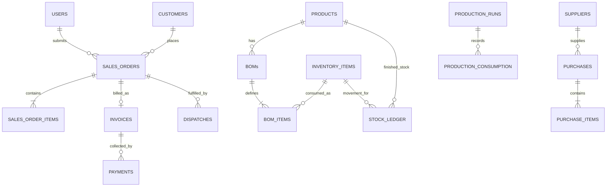

# SmartFactory ERP — Design Note

## 1. Architecture and data model

SmartFactory ERP is a responsive HTML/Bootstrap/JavaScript website backed by an Express REST API and MySQL 8. The same API supports the salesman's phone, factory desktop, production station and read-only auditor role. JWT identifies the user; role middleware limits each API to the required permissions.

The ER relationship sketch is in [`er-diagram.mmd`](er-diagram.mmd); API routes are indexed in [`api-reference.md`](api-reference.md). Core entities are `users`, `customers`, `suppliers`, `products`, `inventory_items`, `boms`, `bom_items`, `purchases`, `purchase_items`, `stock_ledger`, `production_runs`, `production_consumption`, `sales_orders`, `sales_order_items`, `invoice_sequences`, `invoices`, `dispatches`, `dispatch_items`, `payments`, `credit_notes` and `audit_logs`. A finished-good ledger movement references a product ID; raw and packaging movements reference an inventory-item ID. Every ledger movement carries a source type and source document ID.

## 2. Stock and BOM calculation

Closing stock is not a manually edited field. For each item:

`Closing = OPENING + RECEIPT + PRODUCTION_IN + RETURN_IN + ADJUSTMENT_IN − ISSUE − SALE − ADJUSTMENT_OUT`

A BOM stores standard raw and packaging quantities per batch and expected good-packet yield. The production service converts each BOM quantity to the inventory item's base unit, locks relevant ledger rows, validates stock, records planned and actual consumption, issues the actual amount and posts actual good output to finished stock in one InnoDB transaction. A failure rolls back every write. Consumption variance is `(actual − planned) / planned × 100`; yield variance is `(actual good output − expected output) / expected output × 100`. Values outside the 3% tolerance are flagged.

The benchmark uses one 200-packet batch. Actual output is 188 good packets; 12 packets are recorded as yield loss and 6 pouches as damaged. Actual material use is 40 kg flour, 10.5 L oil, 1.2 kg spice, 194 pouches and 9 cartons. Closing raw/packaging balances are 120 kg flour, 19.5 L oil, 3.8 kg spice, 306 pouches and 21 cartons. Finished stock moves from 50 to 238, then to 88 after dispatch of 150 packets.

## 3. Sales, GST and audit trail

A salesman submits an order. Admin may edit it, verifies available finished stock, then approves it. An approved order can be invoiced; dispatch is a separate transaction and reduces finished stock. Tamil Nadu state code `33` results in CGST and SGST; another state code results in IGST. Invoice numbering uses a transaction-locked financial-year sequence row so simultaneous billing requests cannot allocate the same number. GST is calculated in integer paise and the intra-state split preserves the complete rounded tax amount. Payments are allocated to an invoice and cannot exceed its outstanding balance. A posted invoice is not deleted; a credit note records cancellation, and the prototype blocks cancellation after dispatch or payment because return/refund adjustments must first be recorded.

Workflow writes create audit records with user, action, entity and timestamp. Posted stock movements are append-only; corrections should be represented by compensating transactions rather than overwriting a balance.

## 4. Costing method

The prototype uses a perpetual moving weighted-average cost for raw and packaging materials. The ledger's signed stock value and signed on-hand quantity determine the current average; an issue reduces quantity and value at the current average, while a new receipt updates the average using the new receipt rate. Actual consumed quantity is multiplied by the current average. Labour and gas/power are added to the run and allocated across good packets: `(material + labour + utilities) / actual good output`. For the benchmark, material cost is approximately ₹4,055, overhead is ₹1,800, total run cost is ₹5,855 and cost per good packet is approximately ₹31.14.

## 5. Simplified relationship map

## 6. Security and assumptions

Passwords are bcrypt-hashed; JWT protects API routes; role middleware distinguishes salesman, admin, production and accountant access. Order, invoice and payment monetary values use integer paise before persistence. BOM versions are serialized by locking the parent product row and have a unique product/version constraint. The sample factory is in Tamil Nadu and all GSTIN values are fictitious. The benchmark assumes a carton contains 20 packets. This is an internship prototype; mixed GST rates per invoice, statutory GST validation, native XLSX, Tally integration and batch/expiry tracking are outside the current scope.
